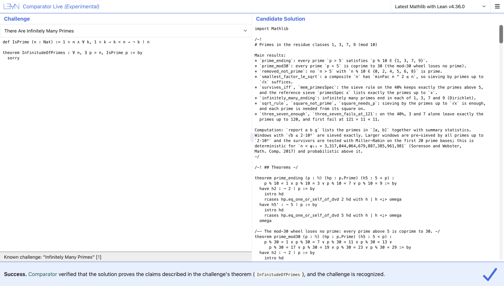
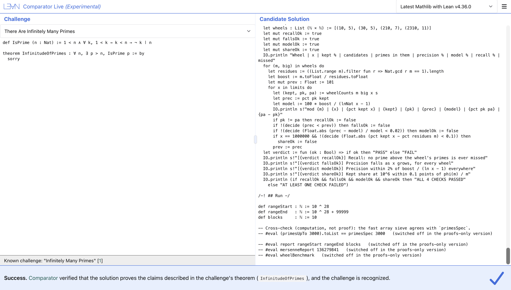

# Prime Endings

**Primes through their last digit: a measured, audited and machine-verified study.**

Every prime above 5 ends in 1, 3, 7 or 9. This project starts from that one fact and follows it as far as it goes: how many primes the 40% of numbers with those endings contain, how fast that share falls, how the four endings compare, how primes ending in 1 are spaced, and what it takes to get from the 40% down to the primes alone. Every number is computed and checked against independent software. The central facts are proved in Lean 4 and checked by the Lean kernel.

**Step-by-step account of everything done, with results:** [WALKTHROUGH.md](WALKTHROUGH.md) ([PDF](docs/Walkthrough.pdf)).

**Papers (journal format):**
* [A window form of the sieve of Eratosthenes on the residues prime to ten, with a machine-checked proof](papers/sieve-window/sieve-window.pdf) (6 pages)
* [The decimal sieve through the Riemann zeta function and a Dirichlet L-function](papers/zeta-map/zeta-map.pdf) (4 pages)

**License:** code under MIT, papers and written documentation under CC BY 4.0 (see [License and citation](#license-and-citation)). To cite this work, use [CITATION.cff](CITATION.cff).

> **What this is and is not.** Every result here is already known to mathematics, most of it for over a century (see [Prior work](#prior-work)). This is not a new discovery. It is a careful rediscovery: each claim is computed from scratch, tested against ground truth, audited, and where possible formally proved.

---

## How this project was made

This project is mine; the work was done with the help of an AI assistant, **Claude Opus 5.5** (model `claude-opus-5-5`, by Anthropic), used through **Claude Code** on my Mac between 15 and 18 November 2026. The split of the work was:

| I did | The assistant did, at my direction |
|---|---|
| Had the starting idea: keep 2, 3 and 5, throw away the 60% of numbers ending in 0, 2, 4, 5, 6, 8, then remove the multiples of primes from the remaining 40% | Wrote the Python scripts for each step and ran them on my machine |
| Asked every question, one step at a time: density, endings, spacing, the multiples grid, the square-root rule, huge numbers, the zeta function | Checked every number against independent software (primecount, sympy, mpmath) and saved the outputs in [`results`](results) |
| Decided what counts as "our model" (the method itself, with a density derived from mathematics, not one trained on data) and corrected wrong framings along the way (for example, that 2, 3 and 5 are kept, never removed) | Drafted the Lean proofs and compiled them against Mathlib locally before I ran them |
| Ran every proof check myself on Comparator Live, using the site's own challenge | Built the interactive multiples grid, wrote this README, the [WALKTHROUGH](WALKTHROUGH.md) and the [papers](papers), and checked every reference against its Crossref record |
| Decided what is published, under which license, and when | Kept the repository in order: commits, PDFs, and the record of every run |

**Why the results do not depend on trusting the assistant.** Every number is recomputed by a script that anyone can run, every proof is checked by the Lean kernel (on Comparator Live, not just on my machine), and mistakes made along the way were caught by these checks and are recorded rather than hidden, for example the gap share corrected from 43.9% to 44.53%, an ending count that was off by one, and the counting formula that turned out to need x ≥ 25.

---

## What is proved, at a glance

**30 theorems, all checked by Lean on Comparator Live in run 10 (18 November 2026).** Each name links to its line in [`lean/Solution.lean`](lean/Solution.lean); each heading links to the section that explains it. Screenshots of the run, with the exact file checked, are in [Certified on Comparator Live](#certified-on-comparator-live-the-latest-runs).

**[The filter (the 40%)](#the-idea-in-one-table)**
* Every prime above 5 ends in 1, 3, 7 or 9 ([`prime_ending`](lean/Solution.lean#L34); explained in [Proof 1](#proof-1-why-every-prime-above-5-ends-in-1-3-7-or-9)).
* No number above 5 ending in 0, 2, 4, 5, 6 or 8 is prime ([`removed_not_prime`](lean/Solution.lean#L69)).
* The stricter mod-30 filter also loses no prime ([`prime_mod30`](lean/Solution.lean#L45); see [bigger filters](#6-bigger-filters-precision-and-recall)).

**[The sieve](#4-sieving-the-40-leaves-exactly-the-primes)**
* Every composite number has a prime factor whose square is at most the number ([`smallest_factor_le_sqrt`](lean/Solution.lean#L76)).
* Crossing out the multiples of the primes up to √x leaves only primes ([`sqrt_rule`](lean/Solution.lean#L169)).
* Every prime p has to be used from p × p onwards, or p × p would survive ([`square_not_prime`](lean/Solution.lean#L176), [`square_needs_p`](lean/Solution.lean#L185)).
* A number survives the sieve on the 40% exactly when it is a prime above 5 ([`survives_iff`](lean/Solution.lean#L120); explained in [Proof 3](#proof-3-the-sieve-keeps-exactly-the-primes)).
* The reference sieve lists exactly the primes up to x ([`mem_primesSpec`](lean/Solution.lean#L143)).

**[The sieve on any range [a, b]](papers/sieve-window/sieve-window.pdf)**
* If p ends in 1, 3, 7 or 9, then p × k is in the 40% exactly when k is ([`mul_coprime_ten`](lean/Solution.lean#L227)).
* The start and stop multipliers, max(p, ⌈a/p⌉) and ⌊b/p⌋, give exactly the multiples of p from p × p onwards that fall in [a, b] ([`multiplier_range`](lean/Solution.lean#L233)).
* In any range, what survives is exactly the primes in it, with none lost and no non-prime left ([`window_sieve`](lean/Solution.lean#L250); tested on a 42,000-digit window in [WALKTHROUGH step 16](WALKTHROUGH.md)).

**How far the primes we know can reach**
* The primes up to Y decide every number below (Y + 1)²: a number there that none of them divides is prime ([`known_primes_reach`](lean/Solution.lean#L299)).
* The primes up to Y determine all the primes up to Y × Y. Each prime p is found at p but first needed at p × p, so the sieve, run upwards from 1, always finds every prime before it needs it ([`bootstrap`](lean/Solution.lean#L313)).
* But no fixed list of primes is enough forever: whatever list you stop at, the square of the next prime gets through ([`known_primes_not_enough`](lean/Solution.lean#L335)).

**[Using only 3 and 7](WALKTHROUGH.md)**
* They are enough to leave only primes up to 120 ([`three_seven_enough`](lean/Solution.lean#L194)).
* They first fail at 121 = 11 × 11 ([`three_seven_fails_at_121`](lean/Solution.lean#L210)).
* The counting formula gives 22, 27 and 28 left at 100, 120 and 121 ([`left37_100`](lean/Solution.lean#L220), [`left37_120`](lean/Solution.lean#L221), [`left37_121`](lean/Solution.lean#L222)).

**[Infinitely many primes](#proof-2-infinitely-many-primes-through-the-40)**
* For any n there is a prime above n that ends in 1, 3, 7 or 9 ([`candidate_prime_above`](lean/Solution.lean#L82)).
* There are infinitely many primes: the site's own challenge ([`InfinitudeOfPrimes`](lean/Solution.lean#L346)).
* Each ending, 1, 3, 7 and 9, has infinitely many primes ([`infinitely_many_ending`](lean/Solution.lean#L100), using Mathlib's Dirichlet theorem; see [the four endings](#3-the-four-endings-get-almost-exactly-equal-shares)).

**Checked numbers**
* 1 ÷ 0.4 = 2.5 ([`density_factor`](lean/Solution.lean#L354)).
* 97 is prime and 91 is not ([`prime_97`](lean/Solution.lean#L356), [`not_prime_91`](lean/Solution.lean#L358)).
* There are 38 kept numbers up to 100 and 3,999,999,998 up to 10^10 ([`candidateCount_100`](lean/Solution.lean#L369), [`candidateCount_1e10`](lean/Solution.lean#L371)).
* The record prime 2^136,279,841 − 1 has 41,024,320 digits, and 332,192,807 is the first exponent giving 100 million digits ([`record_digits`](lean/Solution.lean#L583), [`first_exponent_100M`](lean/Solution.lean#L585)). These two rest on a 40-digit value of log10 2, not on a proof from first principles.

**[Still not proved in Lean](#the-lean-proofs)**
* The density formula 2.5 / (ln x − 1): it needs the prime number theorem, which Mathlib does not have yet. It is tested instead, and is within 0.4% up to 10^10 ([results, section 1](#1-the-share-of-primes-in-the-40-falls-exactly-as-our-model-predicts)).
* That the fast array code in the Lean file gives the same list as the proved reference sieve: they are compared by computation, not proof.
* The counting formula over the 40% (Legendre's method): checked by computation for every x up to 3,000, not proved ([paper 1](papers/sieve-window/sieve-window.pdf)).

---

## Contents

0. [How this project was made](#how-this-project-was-made)
0. [What is proved, at a glance](#what-is-proved-at-a-glance)
1. [The question in plain words](#the-question-in-plain-words)
2. [Terms and formulas used everywhere below](#terms-and-formulas-used-everywhere-below)
3. [The idea in one table](#the-idea-in-one-table)
4. [How the project came about](#how-the-project-came-about)
5. [Results](#results), each with what was measured, how, the numbers, and what they mean
6. [The Lean proofs](#the-lean-proofs)
7. [Papers](#papers)
8. [What "verified by Lean" means](#what-verified-by-lean-means)
9. [What the code can do](#what-the-code-can-do)
10. [How to run it](#how-to-run-it)
11. [Prior work](#prior-work)
12. [Limits](#limits)
13. [License and citation](#license-and-citation)
14. [Glossary](#glossary)

---

## The question in plain words

A prime is a whole number above 1 whose only divisors are 1 and itself: 2, 3, 5, 7, 11, 13, ... Apart from 2 and 5, every prime ends in 1, 3, 7 or 9, because a number ending in an even digit is divisible by 2 and a number ending in 5 is divisible by 5.

So if you want to find primes, you can throw away 60% of all numbers at once and lose nothing except 2 and 5, which you keep by hand (3 is kept by hand too, for a reason explained in the next section). This project asks what happens next:

* How many of the remaining 40% are prime, and how does that share change as numbers get bigger?
* Can the share be predicted from mathematics, using only what our filter does plus the prime number theorem? And does a curve fitted to data alone agree?
* Do the four endings 1, 3, 7, 9 get equal shares of the primes?
* How do you get from the 40% down to exactly the primes (the sieve), and can that be proved correct by a computer?

---

## Terms and formulas used everywhere below

Most of the confusion in earlier versions came from two different "densities" and three different formulas being shown side by side without saying which was which. This section fixes the vocabulary; every table below uses it.

### The counts

| Symbol | Meaning | Example at x = 100 |
|---|---|---|
| x | The upper limit: we look at the numbers 1, 2, ..., x | 100 |
| π(x) | The number of primes up to x (said "pi of x"; nothing to do with 3.14) | 25 |
| kept numbers, C(x) | The numbers above 5 and up to x that end in 1, 3, 7 or 9. Formula: 4 × ⌊x / 10⌋ + (how many of 1, 3, 7, 9 are ≤ the last digit of x) − 2. The "− 2" removes 1 and 3, which end in 1 and 3 but are not above 5 | 38 |
| kept primes | Primes inside the kept numbers: every prime except 2, 3 and 5, so π(x) − 3 | 22 |

The prime 3 ends in 3 but is not "above 5", so it is counted with 2 and 5 as one of the three primes handled separately. That is why the kept primes are π(x) − 3, not π(x) − 2.

### Two kinds of density

* **Average share up to x**: (kept primes) ÷ (kept numbers). Out of all the kept numbers from 6 to x, what fraction is prime? At x = 100 it is 22 / 38 = 57.9%. This is what the main tables report.
* **Local share near x**: the same fraction, but counted only in a narrow window just below x (for example the last million numbers). It answers "if I pick a kept number of about this size, how likely is it to be prime?" It is always a little lower than the average share, because the average includes the smaller numbers, where primes are more common.

### Our model: the method, and the density it predicts

**Our model is the method itself**, in three steps:

1. Take every number from 1 to x.
2. Strip the 60%: keep only the numbers above 5 that end in 1, 3, 7 or 9, and set 2, 3 and 5 aside as known primes.
3. Cross out the multiples of every prime from 3 up to √x (skipping 5, whose multiples are already gone).

What is left, plus 2, 3 and 5, is **exactly** the list of primes up to x. This part is not an estimate: it is checked number by number up to 10^8 (results, section 4) and proved for every x in Lean (`survives_iff`, `window_sieve`).

**The density the model predicts, from mathematics alone, with nothing trained.** How many of the kept numbers will be prime? The answer has two factors, and it matters where each one comes from:

| Factor | Value | Where it comes from |
|---|---|---|
| Concentration from step 2 | **2.5** | **Our filter.** It keeps 4 of every 10 numbers (40%) and loses no prime above 5, so primes become 10 ÷ 4 = 2.5 times more common among what is kept. This is exact arithmetic, proved in Lean (`prime_ending`, `removed_not_prime`). |
| Share of primes among all numbers up to x | **1 / (ln x − 1)** | **The prime number theorem** (Hadamard and de la Vallée Poussin, 1896), which gives π(x) ≈ x / (ln x − 1). This factor cannot come from our filter, because the filter only knows about 2 and 5. |

Multiplying them gives **our model's prediction**:

* **Average share up to x = 2.5 / (ln x − 1)**
* **Local share near x = 2.5 / ln x** (near x, a number is prime with probability about 1 / ln x; inside the 40%, 2.5 times that).

**Why not get the second factor from step 3 as well?** Step 3 crosses out a fraction 1/p for each prime p, so it is tempting to predict the density by multiplying (1 − 1/p) over the primes up to √x. That "product rule" is tested in results section 4: it is almost perfect for small primes but ends up 5.68% too high at 10^8, and Mertens' theorem shows the error grows to 12.3% in the limit. So the counting of step 3 needs the prime number theorem to come out right. Our steps tell you *which* numbers are prime exactly; the prime number theorem tells you *how many* there will be.

ln x is the natural logarithm of x (ln 10 ≈ 2.3026, ln 10^8 ≈ 18.42). It grows very slowly, which is why the share falls slowly.

### A side experiment: a curve fitted to data (not the model)

Before using the mathematics, we tested whether the data alone would lead to the same formula. We gave the computer only the measured average shares at 200 values of x between 1,000 and 400,000, told it to fit the shape a / (ln x − b), and let it choose a and b. It returned **2.5694 / (ln x − 0.7918)**: the same shape as our model's 2.5 / (ln x − 1), with constants close to 2.5 and 1.

Fitting method: if share = a / (ln x − b), then 1 / share = (1/a) ln x − b/a, a straight line in ln x, so an ordinary least-squares line through the 200 points gives a and b. Script: [`python/steps/step1_density.py`](python/steps/step1_density.py).

This fitted curve is **only a check**. It confirms that the data point to our model's formula, but because its constants were tuned to small numbers it drifts as x grows, so all predictions in this project use the derived 2.5 / (ln x − 1) and 2.5 / ln x.

**"Error" in every table means relative error:** (prediction − true value) ÷ true value. +1.19% means the prediction is 1.19% too high.

---

## The idea in one table

Every number from 1 to **x = 10,000,000,000** (ten billion), sorted by last digit and counted exactly ([`data/breakdown_by_ending.csv`](data/breakdown_by_ending.csv)). The "Prime" and "Not prime" columns are percentages of **all ten billion numbers**, not of the row.

| Group | Count | Prime | Not prime | Total |
|--------------------------|----------------:|------------------:|----------------:|--------:|
| Ends in 1 (above 5) | 999,999,999 | 1.1376% | 8.8624% | 10% |
| Ends in 3 (above 5) | 999,999,999 | 1.1377% | 8.8623% | 10% |
| Ends in 7 | 1,000,000,000 | 1.1376% | 8.8624% | 10% |
| Ends in 9 | 1,000,000,000 | 1.1376% | 8.8624% | 10% |
| **Kept (40%)** | **3,999,999,998** | **4.5505%** | **35.4495%** | **40%** |
| Even numbers | 5,000,000,000 | the prime 2 (kept) | 4,999,999,999 | 50% |
| Ends in 5 | 1,000,000,000 | the prime 5 (kept) | 999,999,999 | 10% |
| The numbers 1 and 3 | 2 | the prime 3 (kept) | 1 | 0% |
| **Removed (60%)** | **6,000,000,002** | **3 primes, kept separately** | **5,999,999,999** | **60%** |
| **All numbers** | **10,000,000,000** | **4.5505%** | **95.4495%** | **100%** |

How to read it:

* "Ends in 1" has 999,999,999 numbers, not a billion, because 1 itself is not above 5 and is listed with 3 in its own row.
* 4.5505% of all numbers up to ten billion are prime: 455,052,508 kept primes plus 2, 3 and 5.
* Inside the kept 40%, the average share is 4.5505 ÷ 40 = **11.38%**. The filter has raised the chance that a number is prime by the factor 2.5, from 4.55% to 11.38%, without losing a single prime.

---

## How the project came about

The project grew one question at a time. Each step has a script in [`python/steps`](python/steps) and its saved output in [`results`](results). The full story, with every intermediate result, is in [WALKTHROUGH.md](WALKTHROUGH.md).

| Step | Question | Method | Answer |
|-------|----------------------------|-----------------------|--------------------------------------------------|
| 1 | Can the share of primes in the 40% be predicted? | Compare our model's derived formula 2.5 / (ln x − 1), and a curve fitted to x ≤ 400,000, with true counts | Yes. Our model's formula is within 0.13% at 10^13; the fitted curve agrees in shape and stays within 2% |
| 2 | How does the share change each time x grows ten-fold? | Measure the drop per power of ten; compare with our model's prediction | The drop shrinks every time, by about ln 10 / ln x |
| 3 | Does it hold up to 10 trillion? | Exact prime counts from primecount | Yes. 346,065,536,836 of the 3,999,999,999,998 kept numbers up to 10^13 are prime (8.65%) |
| 4 | Do the four endings behave the same? | Count primes by ending up to 10^10 with a segmented sieve | Almost exactly: 11.376% each. Endings 1 and 9 sit very slightly lower (Chebyshev's bias) |
| 5 | How are primes ending in 1 spaced? | Every gap between consecutive primes ending in 1 near 10^9; two models compared | Average gap 4 ln x; gaps divisible by 30 strongly favoured, as Hardy and Littlewood predicted |
| 6 | Sieving the 40% by 3, 7, 11, ... up to √x: what is left? | Cross out multiples up to 10^8; check every survivor | Exactly the primes |
| 7 | Is all of the above code correct? | 13 checks against independent software | 13 of 13 pass |
| 8 | Do bigger filters (mod 30, 210, 2310) help? | Precision, recall and timing | They raise precision, lose no prime, but save little time |
| 9 to 13 | Multiples, the square-root rule, the zeta function | See WALKTHROUGH steps 9 to 13 | See [WALKTHROUGH.md](WALKTHROUGH.md) |

A Lean 4 file then proves the central facts formally; see [The Lean proofs](#the-lean-proofs).

---

## Results

All figures below are copied from [`results`](results), produced by the scripts in this repository.

### 1. The share of primes in the 40% falls, exactly as our model predicts

**What was measured.** The average share up to x (kept primes ÷ kept numbers) for x = 10^4 to 10^13, compared with our model's prediction 2.5 / (ln x − 1) and with the fitted curve from the side experiment.

**How.** Exact prime counts: a sieve up to 10^8, the program primecount above that, cross-checked where they overlap. Our model's prediction uses no data at all. The fitted curve saw only x between 1,000 and 400,000, so every row from 10^6 on is a test on numbers it never saw. Source: [`results/step3_to_10_trillion.txt`](results/step3_to_10_trillion.txt).

| x | Kept numbers | Kept primes | True average share | **Our model, 2.5 / (ln x − 1)** | **Error** | Fitted curve (check only) | Error |
|--------|-----------------:|-----------------:|-------------:|---------:|----------:|----------:|----------:|
| 10^4 | 3,998 | 1,226 | 30.6653% | 30.4494% | −0.70% | 30.5207% | −0.47% |
| 10^6 | 399,998 | 78,495 | 19.6238% | 19.5076% | −0.59% | 19.7286% | +0.53% |
| 10^8 | 39,999,998 | 5,761,452 | 14.4036% | 14.3508% | −0.37% | 14.5749% | +1.19% |
| 10^10 | 3,999,999,998 | 455,052,508 | 11.3763% | 11.3503% | −0.23% | 11.5562% | +1.58% |
| 10^13 | 3,999,999,999,998 | 346,065,536,836 | 8.6516% | 8.6405% | **−0.13%** | 8.8169% | +1.91% |

**What it means.**
* **Our model's prediction gets better as x grows:** −0.70% at 10^4, −0.13% at 10^13. Nothing in it was tuned; the 2.5 is our filter and the (ln x − 1) is the prime number theorem.
* **The fitted curve gets worse as x grows:** −0.47% at 10^4, +1.91% at 10^13. It was tuned to small numbers, so it is slightly better than our model only at 10^4, close to its training data, and drifts beyond.
* **The two agree in shape.** Data alone led to a / (ln x − b) with a ≈ 2.57 and b ≈ 0.79, close to our model's 2.5 and 1. That is independent support for the formula; the formula itself does not depend on it.

**Our method itself, run to 10^10.** The true counts above come from a standard sieve and from primecount. To test our method directly, [`python/steps/step14_method_to_1e10.py`](python/steps/step14_method_to_1e10.py) runs exactly our three steps (strip the 60%, keep endings 1, 3, 7, 9, cross out p × k for primes p up to √x and multipliers k ending in 1, 3, 7, 9) in blocks of 10^8, all the way to 10^10, in 55 seconds. Source: [`results/step14_method_to_1e10.txt`](results/step14_method_to_1e10.txt).

| x | Kept after step 2 | Survivors of step 3, plus 2, 3, 5 | True prime count (primecount) | Equal? | Share | Our model's prediction | Error |
|---|---:|---:|---:|:---:|---:|---:|---:|
| 10^8 | 39,999,998 | 5,761,455 | 5,761,455 | yes | 14.4036% | 14.3508% | −0.37% |
| 10^9 | 399,999,998 | 50,847,534 | 50,847,534 | yes | 12.7119% | 12.6754% | −0.29% |
| 10^10 | 3,999,999,998 | 455,052,511 | 455,052,511 | yes | 11.3763% | 11.3503% | −0.23% |

So both halves of our model are tested on the same run: the method finds exactly the right number of primes, and the derived prediction matches their share to within 0.4%.

**Local share, for comparison** (same file; the last million numbers below x, or fewer for small x, against our model's local prediction 2.5 / ln x):

| x | Local share near x | Our model, 2.5 / ln x | Error |
|---|---:|---:|---:|
| 10^8 | 13.5830% | 13.5717% | −0.08% |
| 10^10 | 10.8633% | 10.8574% | −0.05% |
| 10^13 | 8.3065% | 8.3518% | +0.55% |

The local share near 10^8 (13.58%) is lower than the average share up to 10^8 (14.40%), as expected: the average includes all the smaller numbers. Do not compare a local value with the average formula or the reverse; each formula belongs to one kind of share.

### 2. How much the share drops each time x grows ten-fold

**What was measured.** For each step from x to 10x, the **drop**: how much the average share falls, as a percentage of its old value. Also the **growth**: how many times more kept primes there are at 10x than at x.

**How.** From the counts above. The **predicted drop** uses our model's formula 2.5 / (ln x − 1) at both ends: 1 − (ln x − 1) / (ln 10x − 1). Simplified, this is about ln 10 / ln x ≈ 2.3 / ln x, which is why the drop keeps shrinking. Source: [`results/step3_to_10_trillion.txt`](results/step3_to_10_trillion.txt).

| Step | Measured drop | Predicted drop | Growth of kept primes | Measured ÷ predicted |
|--------------------|---------:|-------------:|----------------------:|------------------:|
| 10^4 to 10^5 | 21.82% | 21.90% | × 7.82 | 0.996 |
| 10^8 to 10^9 | 11.75% | 11.67% | × 8.83 | 1.006 |
| 10^12 to 10^13 | 7.98% | 7.96% | × 9.20 | 1.003 |

**What it means.** Every ten-fold step multiplies the number of primes by a factor that rises towards 10 but never reaches it, so the share keeps falling, but more and more slowly. The measured drop agrees with our model's prediction to within 1% at every step.

### 3. The four endings get almost exactly equal shares

**What was measured.** Primes up to 10^10, split by last digit. Source: [`results/step4_endings.txt`](results/step4_endings.txt) (segmented sieve, totals checked against primecount).

| Ending | Kept numbers | Primes | Share prime |
|---|---:|---:|---:|
| 1 | 999,999,999 | 113,761,519 | 11.3762% |
| 3 | 999,999,999 | 113,765,624 | 11.3766% |
| 7 | 1,000,000,000 | 113,764,039 | 11.3764% |
| 9 | 1,000,000,000 | 113,761,326 | 11.3761% |

**What it means.** Each ending holds almost exactly a quarter of the primes. The tiny pattern is that endings 3 and 7 together are ahead of 1 and 9 by 6,818 primes out of 455 million (0.0015%). This is **Chebyshev's bias** (Rubinstein and Sarnak, 1994). The usual explanation: if you count primes *and* squares of primes together, the four endings come out level to first order; but every prime squared (above 5) ends in 1 or 9, so those squares take up part of the 1-and-9 share, leaving slightly fewer actual primes there. The lead is real but vanishingly small as a fraction, and in the long run each ending gets exactly one quarter (the prime number theorem for arithmetic progressions).

### 4. Sieving the 40% leaves exactly the primes

This section has two separate things in it, and they must not be confused:

* **The sieve itself** is an exact procedure. It is not a model and makes no prediction; it either crosses a number out or it does not. Its result has **zero error**.
* **The product rule** is a quick estimate, from 1874-era probability reasoning, of how many numbers the sieve *will* leave. It is not our model's prediction: it is the naive way of turning step 3 into a count, shown to see where it breaks down.

**What was done.** Start from the 39,999,998 kept numbers up to x = 10^8. Cross out the multiples of 3, then of 7, 11, 13, and so on, up to 9,973, the largest prime below √10^8 = 10,000. (Why stop at √x: any composite number has a prime factor no bigger than its square root, so once every prime up to √x has been used, only primes can remain. This is proved in Lean as `sqrt_rule`.) After each prime, count what is left.

**The product rule.** A prime p divides about 1 in p numbers, so crossing out its multiples should keep a fraction (1 − 1/p) of what is left. Multiplying these fractions gives the estimate: after 3, 39,999,998 × 2/3; after 3 and 7, 39,999,998 × 2/3 × 6/7; and so on. This assumes that "divisible by 3", "divisible by 7", ... behave like independent coin flips.

Source: [`results/step6_sieve_the_40.txt`](results/step6_sieve_the_40.txt) and [`results/step7_audit.txt`](results/step7_audit.txt). The last column is the error of the product rule, as defined in the formulas section.

| Crossed out so far | Numbers left (exact, from the sieve) | Product rule estimate | Product rule error |
|----------------------------|---------------:|-----------------------:|----------:|
| (start: the 40%) | 39,999,998 | | |
| 3 | 26,666,665 | 26,666,665 | 0.000% |
| 3 to 13 | 19,180,822 | 19,180,818 | 0.000% |
| 3 to 31 | 15,285,217 | 15,285,214 | 0.000% |
| 3 to 97 | 12,029,474 | 12,031,728 | +0.019% |
| 3 to 997 | 8,087,521 | 8,096,526 | +0.111% |
| 3 to 9,973 (all primes up to √x) | **5,761,452** | 6,088,469 | **+5.68%** |

**How to read it.**
1. **The sieve is exact.** The 5,761,452 numbers left at the end are exactly the primes above 5 up to 10^8, checked one by one against an independent prime list. No prime was lost, no composite survived.
2. **The product rule is excellent while the primes used are small, and fails at the end.** Up to 997 (a tenth of √x) it is within 0.11%. Using the last primes, from 997 up to 9,973, its error jumps to +5.68%. The reason: the coin-flip assumption only holds while the primes used are much smaller than √x. Near √x the events stop being independent (for example, a number below 10^8 cannot be divisible by two different primes that are both above 10,000). Mertens' theorem (1874) shows that, used all the way to √x, the product rule always ends up too high, by a factor that approaches 2e^−γ = 1.1229 (12.3% too high) as x grows. At 10^8 it has reached 5.68% on its way there.
3. **The right formula for the final count is our model's prediction, not the product rule.** 2.5 / (ln x − 1) × 39,999,998 gives 5,740,304 survivors, an error of −0.37%. That is the prime number theorem; the product rule is a different, cruder estimate.
4. The paper in [`papers/zeta-map`](papers/zeta-map/zeta-map.pdf) quotes the overshoot as 5.6%. It measures it at x = 9,973² instead of 10^8, and over all numbers instead of the 40%, so the figure differs slightly. Both are correct for their own x.

### 5. Spacing between primes ending in 1

**What was measured.** All 1,209,307 primes ending in 1 between 900 million and 1 billion, and the 1,209,306 gaps between consecutive ones. Every gap is a multiple of 10, since both ends finish in 1. Source: [`results/step5_ending1_spacing.txt`](results/step5_ending1_spacing.txt).

**Two models for how often each gap occurs**, both fitted to the same counts for gaps 10 to 300:
* **Random model:** gap counts fall off smoothly (each step of 10 multiplies the count by a fixed ratio, fitted as 0.876). It treats primes as random, with no arithmetic pattern.
* **Hardy-Littlewood model:** the same smooth fall, multiplied by a correction factor for each gap. If an odd prime q (other than 5) divides the gap, the gap is favoured by (q − 1) / (q − 2): × 2 for multiples of 3, × 1.2 for multiples of 7, × 2.4 for multiples of 21. The reason: if the gap is a multiple of 3, then p and p + gap have the same remainder mod 3, so whenever p is not a multiple of 3, neither is p + gap. Such gaps clear the "divisible by 3" test twice as often.

| Result | Measured | Prediction |
|---|---:|---:|
| Average gap | 82.69 | 4 ln x = 82.69 (primes have average spacing ln x, and a quarter of them end in 1) |
| Most common gap | 30 (14.37% of gaps) | Hardy-Littlewood favours 30 by × 2 |
| Share of gaps that are multiples of 30 | **44.53%** | Random model: 29.02% |
| Typical error over gaps 10 to 300 (root mean square) | | Random model 19,430; Hardy-Littlewood model **3,905** |
| Pairs (p, p + 10), both prime and ending in 1 | 103,368 | Hardy-Littlewood pair formula: 102,995 (0.4% off) |

**What it means.** Primes are not spaced at random. The Hardy-Littlewood correction, which uses only divisibility by small primes, cuts the model error by a factor of five.

### 6. Bigger filters: precision and recall

**The idea.** The 40% filter keeps the numbers that share no factor with 10, that is, not divisible by 2 or 5. The same idea works with a bigger number m in place of 10: keep only the numbers that share no factor with m. In computing this kind of filter is called a **wheel**, and m is its size. Four wheels were tested:

| Wheel | Removes multiples of | Remainders kept (out of m) | Fraction of numbers kept |
|---|---|---|---:|
| mod 10 | 2, 5 | 4 of 10: 1, 3, 7, 9 | 40.0% |
| mod 30 | 2, 3, 5 | 8 of 30: 1, 7, 11, 13, 17, 19, 23, 29 | 26.7% |
| mod 210 | 2, 3, 5, 7 | 48 of 210 | 22.9% |
| mod 2310 | 2, 3, 5, 7, 11 | 480 of 2,310 | 20.8% |

**The three terms, precisely.** Each wheel keeps a set of **candidates** (the numbers it does not throw away).

* **Recall** = (primes among the candidates) ÷ (all primes the wheel could have kept). "Could have kept" means every prime up to x except the wheel's own small primes, which every wheel removes by design and adds back by hand (2, 3 and 5 for mod 30, and so on). Recall answers: *did the filter lose any prime?* 100% means none.
* **Precision** = (primes among the candidates) ÷ (number of candidates). It answers: *if I pick a candidate, how likely is it to be prime?* It is the same quantity as the average share in section 1, just for a different wheel.
* **Boost** = m ÷ (remainders kept). It is how many times more concentrated the primes become after filtering: the wheel keeps only 1/boost of all numbers, but keeps every prime, so the share of primes rises by the factor boost. For mod 10, 10 ÷ 4 = 2.5 (the familiar 2.5); mod 30, 30 ÷ 8 = 3.75; mod 210, 210 ÷ 48 = 4.375; mod 2310, 2,310 ÷ 480 = 4.8125.

**The predicted column.** This is our model's prediction extended to bigger wheels. Without any filter, the share of primes among all numbers up to x is about 1 / (ln x − 1) (the prime number theorem). A wheel multiplies that share by its boost, so the predicted precision is **boost ÷ (ln x − 1)**. At x = 10^8, ln x − 1 = 17.42, so mod 10 predicts 2.5 ÷ 17.42 = 14.35% and mod 30 predicts 3.75 ÷ 17.42 = 21.53%. For mod 10 this is exactly the theory formula 2.5 / (ln x − 1) from section 1. It is derived, not fitted.

Source: [`results/step8_precision_recall_wheels.txt`](results/step8_precision_recall_wheels.txt), at x = 10^8:

| Wheel | Candidates | Primes among them | Precision (measured) | Precision (predicted: boost ÷ (ln x − 1)) | Recall |
|---|---:|---:|---:|---:|---:|
| mod 10 | 39,999,998 | 5,761,452 | 14.40% | 14.35% | 100% (0 primes missed) |
| mod 30 | 26,666,665 | 5,761,452 | 21.61% | 21.53% | 100% (0 missed) |
| mod 210 | 22,857,141 | 5,761,451 | 25.21% | 25.11% | 100% (0 missed) |
| mod 2310 | 20,779,220 | 5,761,450 | 27.73% | 27.63% | 100% (0 missed) |

(The prime count falls by one for mod 210 and again for mod 2310 because 7 and then 11 become "the wheel's own primes", handled by hand.)

**What it means.**
* **No wheel loses a prime** (recall 100%), as the Lean theorems `prime_ending` and `prime_mod30` prove for mod 10 and mod 30.
* **Bigger wheels raise precision, with diminishing returns:** 14.4% → 21.6% → 25.2% → 27.7%. Going from mod 10 to mod 30 removes a third of the candidates; going from mod 210 to mod 2310 removes only a tenth.
* **The prediction matches every precision to within 0.4%** (relative), with nothing fitted.
* **In practice, the time saved is small.** Finding every prime in the million numbers above 10^12 by running a primality test on each candidate took 1.08 s with no filter and 0.97 s (mod 10) to 0.90 s (mod 2310), a speed-up of only 1.11 to 1.19 times. A primality test already rejects a multiple of 2, 3 or 5 almost instantly, so throwing those numbers away in advance saves little. The filter matters much more for sieving, where every candidate costs memory and work.

### 7. Very large numbers

The Lean report can list primes in a window at any size. In the 100,000 numbers from 10^28 to 10^28 + 99,999 it finds 1,554 primes. That is 1.554%, against 1 / ln(10^28) = 1.551% predicted by the local density of all numbers (no filter here, so no factor 2.5). The mean gap is 64.17 against ln(10^28) = 64.47. Python's sympy finds the same 1,554 primes independently. Above 3.3 × 10^24 these are probable primes; see [Limits](#limits).

---

## The Lean proofs

File: [`lean/Solution.lean`](lean/Solution.lean). Compiled with no errors against Mathlib locally (Lean 4.34, Mathlib commit 818f61d) and on [Comparator Live](https://comparator.live.lean-lang.org) (Lean v4.36, run 10, 18 November 2026). Which run certified what is in the [run log](WALKTHROUGH.md#run-log).

### Certified on Comparator Live: the latest runs

All three runs used the site's own built-in challenge, "There Are Infinitely Many Primes", on Lean v4.36 with the latest Mathlib. The certificate names `InfinitudeOfPrimes`, the site's statement. To check that one theorem, Comparator must first compile the whole solution file, so a pass also means that every other proof in the file was checked by Lean: a single wrong step anywhere would have stopped the build.

**Run 8, 18 November 2026: 24 theorems**



Code: [`lean/runs/run8_SolutionProofsOnly_24_theorems.lean`](lean/runs/run8_SolutionProofsOnly_24_theorems.lean) (SHA-256 starts 886b839d)

What it proved:
* **The filter:** every prime above 5 ends in 1, 3, 7 or 9 (`prime_ending`); no number above 5 ending in 0, 2, 4, 5, 6 or 8 is prime (`removed_not_prime`); the mod-30 filter loses no prime either (`prime_mod30`).
* **The sieve from 1 to x:** a composite number has a prime factor whose square is at most the number (`smallest_factor_le_sqrt`); crossing out the multiples of the primes up to √x leaves only primes (`sqrt_rule`); every prime is needed from its square on (`square_not_prime`, `square_needs_p`); a number survives the sieve on the 40% exactly when it is a prime above 5 (`survives_iff`); the reference sieve lists exactly the primes up to x (`mem_primesSpec`).
* **3 and 7 alone:** enough up to 120 (`three_seven_enough`), first fail at 121 = 11 × 11 (`three_seven_fails_at_121`), and the counting formula gives 22, 27, 28 at 100, 120, 121 (`left37_100`, `left37_120`, `left37_121`).
* **Infinitely many primes:** a prime above any n that ends in 1, 3, 7 or 9 (`candidate_prime_above`); infinitely many primes, the site's challenge (`InfinitudeOfPrimes`); infinitely many primes for each ending (`infinitely_many_ending`).
* **Checked numbers:** `density_factor`, `prime_97`, `not_prime_91`, `candidateCount_100`, `candidateCount_1e10`, `record_digits`, `first_exponent_100M`.

**Run 9, 18 November 2026: all 27 theorems**



Code: [`lean/runs/run9_SolutionProofsOnly_27_theorems.lean`](lean/runs/run9_SolutionProofsOnly_27_theorems.lean) (SHA-256 starts a0e444f0)

What it proved: everything in run 8, plus the sieve on **any range [a, b]**, not only from 1:
* If p ends in 1, 3, 7 or 9, then p × k is in the 40% exactly when k is (`mul_coprime_ten`).
* Starting each prime p at k = max(p, ⌈a/p⌉) and stopping at ⌊b/p⌋ gives exactly its multiples from p × p on that lie in [a, b] (`multiplier_range`).
* In any range, the numbers that end in 1, 3, 7 or 9, are above 5 and are not crossed out are exactly the primes in it: none lost, no non-prime left (`window_sieve`).

**Run 10, 18 November 2026: all 30 theorems**

*(Screenshot to be added: Comparator Live showed "Success ... InfinitudeOfPrimes ... the challenge is recognized" for this file.)*

Code: [`lean/runs/run10_SolutionProofsOnly_30_theorems.lean`](lean/runs/run10_SolutionProofsOnly_30_theorems.lean) (SHA-256 starts 050ccaf2; the same file as [`lean/SolutionProofsOnly.lean`](lean/SolutionProofsOnly.lean))

What it proved: everything in run 9, plus how far the primes we know can reach:
* The primes up to Y decide every number below (Y + 1)² (`known_primes_reach`).
* The primes up to Y determine all primes up to Y × Y, so the sieve finds every prime before it needs it (`bootstrap`).
* No fixed list of primes is enough forever: the square of the next prime always gets through (`known_primes_not_enough`).

Earlier runs (1 to 7), including the first pass of the same challenge on 15 November 2026, are listed in the [run log](WALKTHROUGH.md#run-log).

**What the proofs establish** (all 30 theorems compile with no gaps; see [the run log](WALKTHROUGH.md#run-log) for which runs certified what):

**The filter**
* Every prime above 5 ends in 1, 3, 7 or 9 (`prime_ending`).
* No number above 5 in the thrown-away 60% is prime (`removed_not_prime`).
* The stricter mod-30 filter loses no prime either (`prime_mod30`).

**The sieve**
* Every composite n has a prime factor whose square is at most n (`smallest_factor_le_sqrt`).
* Crossing out the multiples of the primes up to √x leaves only primes (`sqrt_rule`).
* Each prime is needed from its square on: p × p is never prime, and only p divides it (`square_not_prime`, `square_needs_p`).
* A number survives the sieve on the 40% if and only if it is a prime above 5 (`survives_iff`): no prime is lost and no composite gets through.
* The reference sieve lists exactly the primes up to x (`mem_primesSpec`).
* The sieve works on any window [a, b], not only from 1: start each prime p at max(p, ⌈a/p⌉), use only multipliers ending in 1, 3, 7, 9, and what survives is exactly the primes in [max(a, 6), b] (`window_sieve`, with `mul_coprime_ten` and `multiplier_range`).
* The primes up to Y decide every number up to Y × Y, so the sieve finds each prime before it needs it (`known_primes_reach`, `bootstrap`); but no fixed list of primes is enough forever (`known_primes_not_enough`).
* Within the 40%, crossing out 3 and 7 alone is enough up to 120 (`three_seven_enough`) and first fails at 121 = 11 × 11 (`three_seven_fails_at_121`).

**Infinitely many primes**
* There is always a prime above any n inside the 40% (`candidate_prime_above`).
* So there are infinitely many primes (`InfinitudeOfPrimes`, Comparator Live's built-in challenge).
* Each of the endings 1, 3, 7 and 9 has infinitely many primes (`infinitely_many_ending`, from Mathlib's Dirichlet theorem).

**Checked numbers**
* 1 ÷ 0.4 = 2.5 (`density_factor`); 97 is prime and 91 is not (`prime_97`, `not_prime_91`).
* 38 candidates up to 100 and 3,999,999,998 up to 10^10 (`candidateCount_100`, `candidateCount_1e10`).
* Crossing out 3 and 7 leaves 22 numbers up to 100, 27 up to 120 and 28 up to 121, because 121 wrongly survives (`left37_100`, `left37_120`, `left37_121`).
* With a 40-digit value of log10 2, the record prime 2^136,279,841 − 1 has 41,024,320 digits, and 332,192,807 is the first exponent giving 100 million digits (`record_digits`, `first_exponent_100M`).

**What the proofs do not establish, and how each could be proved**

| Not yet proved | Why not | How to prove it |
|---|---|---|
| The density formulas 2.5 / (ln x − 1) and li(x) | They follow from the prime number theorem, which Mathlib does not contain yet | Import the [PrimeNumberTheoremAnd](https://github.com/AlexKontorovich/PrimeNumberTheoremAnd) project once its main theorem is complete, then derive share × ln x → 2.5. Comparator Live only has Mathlib, so this cannot be certified there |
| That the fast array code equals the reference sieve | Its `while` loops compile as `partial` functions, which Lean's logic cannot look inside | Rewrite the loops with structural or well-founded recursion, prove a loop invariant ("entry n is true iff n survives the primes crossed so far"), then prove `primesUpTo x = primesSpec x` |
| The `#eval` outputs | They are computations, not statements | Restate each result as a theorem; small ones close with `decide`. Big ones need `native_decide`, which adds the `Lean.ofReduceBool` axiom that the Comparator setup does not permit |
| The counting formula (Legendre on the 40%) | Not formalised | Inclusion and exclusion over the sieving primes with Mathlib's Möbius function; it needs the condition x ≥ 25 |
| Anything new | All of these are known results | Not applicable |

The sieve on a window [a, b] with a > 1 used to be in this list; it is now proved (`window_sieve`, 17 November 2026).

### Proof 1: why every prime above 5 ends in 1, 3, 7 or 9

The last digit of p is the remainder when p is divided by 10.

1. If p ended in 0, 2, 4, 6 or 8, then 2 would divide p. A prime is divisible only by 1 and itself, so p would have to be 2. But p > 5.
2. If p ended in 5, then 5 would divide p, so p would have to be 5. But p > 5.
3. So 2 does not divide p and 5 does not divide p. The only remainders mod 10 with that property are 1, 3, 7 and 9.

In Lean, steps 1 and 2 are the two `have` blocks, using `Nat.Prime.eq_one_or_self_of_dvd` (a prime's only divisors are 1 and itself). Step 3 is a single call to `omega`, Lean's decision procedure for whole-number arithmetic, which checks every remainder automatically.

### Proof 2: infinitely many primes, through the 40%

This is Euclid's argument, adapted so that the prime it produces lands in the 40%.

Fix any number n. Let

$$N = 10 \cdot (n+5)! + 1,$$

where (n + 5)! = 1 x 2 x 3 x ... x (n + 5). Let p be the smallest prime factor of N (it exists because N > 1).

1. **p is larger than n + 5.** Suppose not, so p is at most n + 5. Then p is one of the factors of (n + 5)!, so p divides 10 x (n + 5)!. It also divides N = 10 x (n + 5)! + 1. A number that divides both A and A + 1 divides their difference, which is 1. No prime divides 1. Contradiction.
2. **p ends in 1, 3, 7 or 9.** p is prime and p > n + 5 > 5, so Proof 1 applies.
3. So p is a prime above n in the 40%. Since n was arbitrary, there are infinitely many.

In Lean this is `candidate_prime_above`:

| Lean line | Meaning |
|--------------------------------------|----------------------------------------------|
| `Nat.factorial_pos` | (n + 5)! is positive, so N is not 1 |
| `Nat.minFac_prime` | the smallest factor of N is prime |
| `Nat.minFac_dvd` | that factor divides N |
| `by_contra` ... `Nat.dvd_factorial` | if p were at most n + 5, it would divide (n + 5)! |
| `Nat.dvd_add_right` ... `Nat.dvd_one` | then p would divide 1, which is impossible |
| `prime_ending _ hp` | so p ends in 1, 3, 7 or 9 |

`InfinitudeOfPrimes` then takes this p and shows it meets the challenge's definition `IsPrime p := 1 < p ∧ ∀ k, 1 < k → k < p → ¬ k ∣ p`: p > 1, and any divisor k of p is 1 or p, so no k strictly between 1 and p divides it.

The factor 10 is what ties the proof to this project. Euclid's classical version uses n! + 1. Here the prime's ending is guaranteed by `prime_ending`.

### Proof 3: the sieve keeps exactly the primes

`Survives n` states the sieve's rule: n is above 5, ends in 1, 3, 7 or 9, and no prime p with p x p ≤ n divides it. Crossing out the odd multiples of each prime p from p x p removes exactly the candidates that break this rule.

1. **A survivor is prime.** If a survivor n were not prime, its smallest prime factor m would satisfy m x m ≤ n (`smallest_factor_le_sqrt`), and m would have crossed n out. Contradiction.
2. **A prime above 5 survives.** It is in the 40% by `prime_ending`. Its only divisors are 1 and itself, and n x n > n, so no prime with p x p ≤ n divides it.

`survives_iff` is this argument. `mem_primesSpec` adds the primes 2, 3 and 5 and concludes that `primesSpec x` is exactly the list of primes up to x.

The fast array sieve used for the reports (`primesUpTo`, `primesBetween`) is a separate, faster implementation. It is compared with `primesSpec` by computation (identical up to 3,000, the `#eval` line in the file), not by proof.

---

## Papers

Two short papers in journal format, written for an academic reader, are in [`papers/`](papers): one on the window sieve and its Lean proof, and one mapping the sieve onto the zeta function. They carry no author name; the repository link is at the bottom of every page, and each ends with a statement citing Claude Opus 5.5 for its part in the work. Every number in them is recomputed by [`papers/verify_numbers.py`](papers/verify_numbers.py) (34 of 34 checks pass).

## What "verified by Lean" means

**Lean** is a programming language and proof assistant. A theorem in Lean is a precise statement plus a proof built from basic logical steps. The **Lean kernel**, a small trusted program, checks every step. If a single step is missing or wrong, the file does not compile. **Mathlib** is Lean's community library of mathematics, more than 200,000 checked definitions and theorems that proofs can build on.

**Comparator** is the Lean project's tool for judging a proof against a statement someone else wrote. It takes a *challenge* file (statements with `sorry` in place of proofs) and a *solution* file, and confirms three things for each named theorem:

1. the solution proves exactly the statement in the challenge (ESTABLISHED as Comparator's documented guarantee, per its [README](https://github.com/leanprover/comparator));
2. it uses no axioms beyond the standard three of Lean's logic (`propext`, `Quot.sound`, `Classical.choice`);
3. the Lean kernel accepts it.

**What has been checked so far.** Every Comparator run is listed, with its outcome, in the [run log](WALKTHROUGH.md#run-log). In short:

* **The built-in challenge "There Are Infinitely Many Primes"** has passed, most recently on 18 November 2026 with all 30 theorems ([`lean/SolutionProofsOnly.lean`](lean/SolutionProofsOnly.lean), run 10). The challenge is the site's own, so its statement did not have to be trusted by us, and a pass also means every other proof in the file compiled.

  Screenshots of the two latest runs, with their code and what each proved, are in [Certified on Comparator Live](#certified-on-comparator-live-the-latest-runs).

* **The local challenge** [`lean/Challenge.lean`](lean/Challenge.lean) with [`lean/config.json`](lean/config.json) now names 22 theorems. It passed on Comparator for the first 6 (run 1). All 22 are also covered by run 10, in which the whole file compiled on Comparator; they use only Lean's three standard axioms.

**What verification does and does not give.**

* It guarantees the proofs are correct. Nothing is assumed or skipped.
* It does not guarantee that a challenge states what was intended. This only matters for a challenge you write yourself: Comparator then asks you to confirm you "trust" it, because it can check the proof against the statement but not the statement against your intention. The site's built-in challenge does not have this weakness, since its statement is the site's own. In this project, a self-written challenge was used once, in run 1 on 15 November 2026 (6 theorems, after confirming trust); every run since has used the site's built-in "There Are Infinitely Many Primes" challenge.
* The `#eval` lines that print reports are computations, not proofs. Their results are checked separately, against primecount and sympy.

---

## What the code can do

### Python ([`python`](python))

| Script | What it does | Time |
|--------------------------------|--------------------------------------------|------|
| `steps/step1_density.py` | Compares our model's prediction 2.5 / (ln x − 1) with true counts, and fits the side-experiment curve on x up to 400,000 | 1 s |
| `steps/step2_relative_change.py` | Per power of ten: kept, removed, density drop, prime growth | 1 s |
| `steps/step3_to_10_trillion.py` | Steps 1 and 2 to 10^13 with every count from primecount | 1 s |
| `steps/step4_endings.py` | Primes by ending up to 10^10, segmented sieve, checked against primecount | 1 min |
| `steps/step5_ending1_spacing.py` | Gaps between primes ending in 1 near 10^9 against Hardy-Littlewood | 4 s |
| `steps/step6_sieve_the_40.py` | Sieves the 40% prime by prime to 10^8 and confirms only primes remain | 2 s |
| `steps/step7_audit.py` | 13 checks of the code and results against independent ground truth | 5 s |
| `steps/step8_precision_recall_wheels.py` | Precision, recall and timing for wheels mod 10, 30, 210, 2310 | 12 s |
| `steps/step10_one_hundred_octillion.py` | Exact counts, filter and multiples at x = 10^29 | 1 s |
| `steps/step11_three_and_seven.py` | The square-root rule worked for 3 and 7, with formulas checked for every x up to 100,000 | 1 s |
| `steps/step12_zeta_map.py` | The 40% filter, the sieve and the endings as pieces of the zeta function | 2 s |
| `steps/step14_method_to_1e10.py` | Runs our three-step method itself to 10^10 in blocks; compares with primecount and with our model's prediction | 1 min |
| `steps/step16_huge_numbers.py` | Our method on a 42,000-digit window: strips the 60%, counts multiples by formula, partial sieve to 10^6 | 2 s |
| `steps/step13_find_zeros.py` | Zeta workings step by step; finds all 138 zeros up to height 300 and proves none were missed | 1 min |
| `make_prime_tables.py` | Writes `data/primes_40pct_up_to_1e6.csv` and `data/breakdown_by_ending.csv` | 1 min |
| `extras/density_models.py` | Compares fitted models with li(x), Riemann's R(x) and up to 1,000 zeta-zero waves | 6 s |
| `extras/legendre_endings.py` | Refits Legendre's 1808 constant from density data; models the bias between endings | 5 s |
| `extras/primes_ml.py` | Density regression, a primality classifier, and gap statistics | 5 s |

Times were measured on an Apple-silicon Mac. Scripts that sieve to 10^9 need about 1 GB of memory.

### Lean ([`lean/Solution.lean`](lean/Solution.lean))

Set `rangeStart`, `rangeEnd` and `blocks` at the bottom of the file and evaluate it in a Lean editor. It prints, for the range:

* how many numbers are kept and removed, and how many primes there are;
* measured density against our model's prediction 2.5 / ln x;
* smallest, largest and every gap between primes;
* counts by ending;
* estimates of the total number of primes up to the range's end, using the 2.5 formula and li(x);
* a table per block, and the primes themselves.

It works at any size:

* **up to about 4 x 10^12**: exact, by the sieve, for ranges up to 1,000,000 numbers wide;
* **above that**: the window is sieved by all primes up to 2,000,000 and the survivors are tested with Miller-Rabin. This is a proof of primality below ψ13 = 3,317,044,064,679,887,385,961,981, the smallest number that fools Miller-Rabin on the first 13 prime bases (Sorenson and Webster, *Mathematics of Computation*, 2017), and gives "probable primes" above it. Ranges up to 200,000 numbers wide.

It also reports on the largest known prime, 2^136,279,841 - 1: its digit count, first and last digits, the next candidate exponents, and the Mersenne primes with exponent below 1,300 (by the Lucas-Lehmer test).

**What it cannot do:** predict which number is prime without testing it. No known method can. The code finds primes by sieving and testing; what it predicts accurately is how many there are.

---

## How to run it

```bash
git clone <this repository>
cd prime-endings
python3 -m venv .venv && source .venv/bin/activate
pip install -r requirements.txt
brew install primecount          # macOS; on Linux use your package manager
python3 python/steps/step7_audit.py
```

For the Lean file, paste [`lean/Solution.lean`](lean/Solution.lean) into [live.lean-lang.org](https://live.lean-lang.org) to see the reports, or into [Comparator Live](https://comparator.live.lean-lang.org) with [`lean/Challenge.lean`](lean/Challenge.lean) to check the proofs.

---

## Prior work

| Result here | Known as | Origin |
|------------------------------|--------------------------|----------------------------|
| Infinitely many primes | Euclid's theorem | Euclid, about 300 BC |
| Each ending holds about a quarter of the primes | Prime number theorem for arithmetic progressions | de la Vallée Poussin, 1896 |
| Endings 1 and 9 lag slightly behind 3 and 7 | Chebyshev's bias | Chebyshev, 1853; Rubinstein and Sarnak, 1994 |
| Density 2.5 / (ln x - 1) on the kept numbers | Prime number theorem, scaled by 10 / φ(10) | Hadamard and de la Vallée Poussin, 1896 |
| Consecutive primes avoid repeating their ending | Consecutive-prime bias | Lemke Oliver and Soundararajan, 2016 |
| Gaps divisible by 30 are favoured | Hardy-Littlewood singular series | Hardy and Littlewood, 1923 |
| Keep only endings 1, 3, 7, 9, then sieve | Wheel factorisation | Pritchard, *Communications of the ACM* 24 (1981) |
| The sieve product overshoots near the square root | Mertens' theorem | Mertens, 1874 |
| Counting without listing (primecount) | Meissel-Lehmer methods | Meissel, 1870; Lehmer, 1959 |

---

## Limits

* Counts above 10^10 by ending were not computed: primecount counts all primes, not primes by ending, and the sieve would take about 15 hours to reach 10^13.
* The Lean report's results above 3.3 x 10^24 are probable primes, as stated in its output. The 1,554 primes found from 10^28 to 10^28 + 99,999 are therefore probable primes in Lean; sympy confirms the same list independently.
* Sieve correctness is proved for the reference sieve `primesSpec` and for any window (`window_sieve`). The faster array sieve is checked against them by computation, not proved equal.
* The 2.5 / (ln x − 1) and 2.5 / ln x formulas are measured and match the prime number theorem, but they are not proved in Lean: that needs the prime number theorem itself, which Mathlib does not yet contain.
* The fitted curve 2.5694 / (ln x − 0.7918) from the side experiment is a description of small-x data, not a law: its error grows slowly with x (+1.9% at 10^13). All predictions use our model's derived formula instead.
* Our model's density prediction rests on the prime number theorem, which is proved in the mathematical literature but not yet in our Lean file (see the Lean section).
* The Lean theorems `record_digits` and `first_exponent_100M` prove what the formula gives with a 40-digit value of log10 2; they match an independent high-precision calculation but are not a proof from first principles.
* Density "predictions" describe how many primes there are, not which numbers are prime.

## License and citation

* **Code** (Python, Lean, tools): MIT. See [LICENSE](LICENSE). Anyone may reuse it if they keep the copyright notice.
* **Papers and written documentation** ([`papers/`](papers), [WALKTHROUGH.md](WALKTHROUGH.md), [`docs/`](docs)): Creative Commons Attribution 4.0 ([CC BY 4.0](papers/LICENSE-CC-BY-4.0.txt)). Anyone may reuse them if they give credit.
* **Contributing:** by request only. Anyone can read, copy and fork the repository, but changes are merged only through a pull request that the owner reviews and approves. See [CONTRIBUTING.md](CONTRIBUTING.md).
* **Citing:** [`CITATION.cff`](CITATION.cff) gives the citation; GitHub shows it as "Cite this repository". No license can require a citation for using an idea or a mathematical result; citing those is an academic norm, which this file makes easy to follow.

---

## Glossary

| Term | Meaning |
|---|---|
| Prime | A whole number above 1 divisible only by 1 and itself |
| π(x) | The number of primes up to x |
| ln x | Natural logarithm of x; ln 10 ≈ 2.3026 |
| Kept numbers, the 40% | Numbers above 5 ending in 1, 3, 7 or 9 |
| Average share | Kept primes ÷ kept numbers, over everything from 6 to x |
| Local share | The same fraction in a narrow window just below x |
| Prime number theorem | π(x) ≈ x / (ln x − 1): how many primes there are up to x; supplies the 1 / (ln x − 1) in our model's prediction |
| Our model | The method (strip the 60%, keep endings 1, 3, 7, 9, cross out multiples of primes up to √x), with its derived density prediction 2.5 / (ln x − 1) |
| Fitted curve | 2.5694 / (ln x − 0.7918): a side experiment fitted to x ≤ 400,000, used only to check our model's formula |
| Relative error | (prediction − true) ÷ true |
| Sieve | Crossing out the multiples of small primes so that only primes remain |
| √x rule | To sieve up to x, crossing out the multiples of the primes up to √x is enough |
| Product rule | The prediction that crossing out p keeps a fraction (1 − 1/p) of what is left |
| Mertens' theorem | Says the product rule, taken up to √x, overshoots by a factor tending to 2e^−γ ≈ 1.1229 |
| Chebyshev's bias | Endings 3 and 7 hold very slightly more primes than 1 and 9 at every height tested |
| Hardy-Littlewood | The prediction that gaps divisible by small primes are favoured by a known factor |
| Precision, recall | Share of kept numbers that are prime; share of primes that are kept |
| Lean, Mathlib | A proof checker, and its library of checked mathematics |
| Comparator | A tool that checks a Lean proof against a stated challenge |
| primecount | A program that counts primes up to x exactly without listing them |

